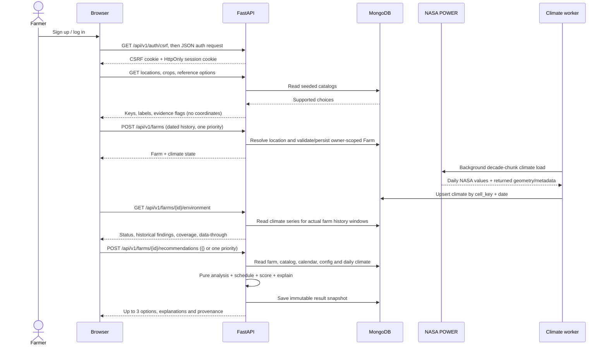

# Current farmer workflow — Product Direction v1

This guide describes the API flow after the Product Direction dated 7 November 2026 and Product Owner clarifications dated 9 November 2026. It supersedes the old NY-39/NY-40 request flow in [`api-workflows.md`](api-workflows.md), which is retained as historical ticket documentation.

## Before farm operations

1. The operator configures MongoDB and runs `python -m app.farms.seed_catalogs` from `backend/` to create missing crop, calendar, location, reference-option and analysis-config records.
2. Map each supported place to NASA's returned grid cell once:

   ```powershell
   python -m app.jobs.resolve_nasa_grid --location-key ejura
   ```

   Repeat for Anyinasu/Kintampo as appropriate. This one-day NASA lookup is an operator action; it does not load 1981-to-current history.
3. After loader fixtures and isolated Mongo/API checks pass, deliberately start a cell backfill with `python -m app.jobs.climate_worker --mode backfill --cell-key <cell-key> --confirm-large-download`. The API can show `pending` or `loading` while the external worker operates.

Do not run backfill against a production database or start all pending cells until an operator has confirmed the target and rollout.

### Verified local development state (9 November 2026)

The configured disposable development database has been seeded and the controlled archive load has completed for all three supported location cells. Each cell is `ready` from 1981-01-01 through 2026-11-06, with five completed chunks and 16,746 unique daily records. The checked records contain no null/missing values for rainfall, mean temperature, or maximum temperature. No farm IDs or farm coordinates are stored in the shared daily records.

| Location key | Opaque NASA cell key | Climate archive | Calendar rows |
|---|---|---|---:|
| `ejura` | `power-7e1cd1128dd976a41e9fdb1c` | Ready through 2026-11-06 | 3 |
| `anyinasu` | `power-ed77a0480fd17405cb00c8ca` | Ready through 2026-11-06 | 4 |
| `kintampo` | `power-ccdd449f1362a7bc29a4212c` | Ready through 2026-11-06 | 0 |

These cell keys are internal identifiers, not coordinates. Kintampo has climate data but no supported crop-calendar windows, so recommendation generation must not invent dates there. Weekly sync is still disabled until a separate scheduled worker is configured and reviewed. A fresh developer or deployment database must be seeded, mapped, and backfilled independently; the records above are not part of source control.

## Farmer request sequence



NASA is not called from the farmer's environment or recommendation requests. If climate is pending or some values are missing, status and coverage are returned, the missing values remain null, and no weather weight change is invented.

## Public choice endpoints

| Method and path | Purpose |
|---|---|
| `GET /api/v1/farms/locations` | Supported location keys/labels and coverage notice. Does not return reference coordinates or NASA geometry. |
| `GET /api/v1/crops?usage=history` | Crops selectable for farmer-reported history. Includes system choices needed to record rice correctly. |
| `GET /api/v1/crops?usage=recommendation` | Crops that are enabled as recommendation candidates. |
| `GET /api/v1/farms/reference-options` | Soil texture, irrigation, labour, one farmer priority, and rice-system choices. |

These lists come from the backend-managed Mongo catalogs, not frontend hardcoded crop arrays.

## Create and update a farm

`POST /api/v1/farms` and `PATCH /api/v1/farms/{farm_id}` use the authenticated session to set ownership. The body uses a supported location key and one to three actual, oldest-first crop events. Each event points at a catalog crop and includes its real planting and harvest/end dates; a rice event can preserve an unknown production system. The request does not accept an owner ID, private coordinates, NASA period, or future planting dates.

Other farm inputs include labour capacity, at most one farmer priority, soil texture and irrigation access. Soil and irrigation are displayed context; they are not converted into an invented field water-storage estimate. `available_from` defaults to the later of today and the last harvest unless a valid farmer-reported date is provided.

History dates cannot be future dates; end cannot precede start; overlapping sole-crop events are rejected; gaps are allowed. Legacy free-text crop lists are not translated into invented crop IDs or dates and must be re-entered by the farmer.

Example shape (synthetic only):

```json
{
  "name": "Example plot",
  "location_key": "ejura",
  "soil_texture_key": "unknown",
  "irrigation_access_key": "unknown",
  "labour_capacity": "Medium",
  "farmer_priority": "water_security",
  "crop_history": [
    {
      "crop_key": "maize",
      "sequence_order": 1,
      "start_date": "2024-03-15",
      "end_date": "2024-07-01"
    }
  ]
}
```

The API resolves `location_key` to a backend-held public-place coordinate, then uses the exact grid geometry NASA returns. The response shows only the location key/label and safe climate state; coordinates and exact returned geometry stay server-side.

## Environmental status

Call `GET /api/v1/farms/{farm_id}/environment`. It analyzes each saved historical crop event's actual planting-to-harvest period and the separate period from the latest harvest through the climate archive's `data_through` date. It does not generate a rolling 12-month range.

The response reports climate-cell state (`location_unmapped`, `pending`, `loading`, `ready`, `partial`, `error`, or `unavailable`), data coverage, historical findings, source, reference period and data-through date. NASA POWER is a regional gridded historical source, not a farm sensor or forecast. Missing daily values remain null and are not described as zero rain or zero temperature.

## Generate and retrieve recommendations

Call `POST /api/v1/farms/{farm_id}/recommendations` with an empty JSON object, or one optional priority override:

```json
{ "priority": "low_labour" }
```

Allowed priorities are `water_security`, `soil_health`, `fast_turnover`, and `low_labour`; only one may be supplied. Do not include crop history, NASA dates, future planting dates, farm coordinates, owner IDs or scored values in this request. The API loads those inputs from the authenticated Farm/catalog/climate records.

The response contains the environmental status/findings and up to three saved future sequences. Each sequence has three scheduled future crop events, planting dates, maturity-based expected harvest ranges, criterion ratings/weights, rationale, trade-offs, assumptions, evidence and engine/config/catalog/calendar versions. The score is relative to the configured 1–3 rules; it is not a probability, guaranteed yield, field soil diagnosis or profitability estimate. The result is persisted so it can be reviewed later.

Read saved results with:

- `GET /api/v1/farms/{farm_id}/rotation-results`
- `GET /api/v1/farms/{farm_id}/rotation-results/{result_id}`

Every farm/result lookup is constrained by both authenticated owner and resource ID. Missing and non-owned records share the same not-found behavior.

## Edge cases

- Climate not mapped or not loaded: return the safe state and null findings; do not call NASA in the request. Operator mapping/loading is separate.
- Partial weather: preserve per-variable missingness and coverage. A valid adverse indicator may be explained, but unavailable parameters do not acquire values.
- No valid crop/calendar sequence within the horizon: return an empty option list and a reason. Never relax hard constraints to force three results.

New scheduled events can include optional `calendar_evidence` with `source_url`,
`window_basis`, `applicability` and `limitations`. The selected calendar title,
status and version remain on the event. Saved results retain the evidence available
at generation time. Earlier results may omit the evidence object.

Operators can apply the three provisional Kintampo North windows through the
existing `python -m app.farms.seed_catalogs` command in the intended environment.
See the [GAEZ suitability evidence](../../analysis_docs/research/field-shift-gaez-suitability.md)
and the [offline rainfall audit runbook](rainfall-audit.md).
- A profile with historical rice ecology `unknown` is preserved as history, not used as a future rice recommendation.
- A disabled crop or missing location-specific calendar is not substituted with a similar item/window at runtime. Similar-crop analogues belong in the documented seed evidence, not automatic inference during requests.

See [`authentication.md`](authentication.md), [backend operations](../README.md), and the [repository implementation audit](../../analysis_docs/product-direction-implementation.md) for setup, worker commands, evidence details and test status.
